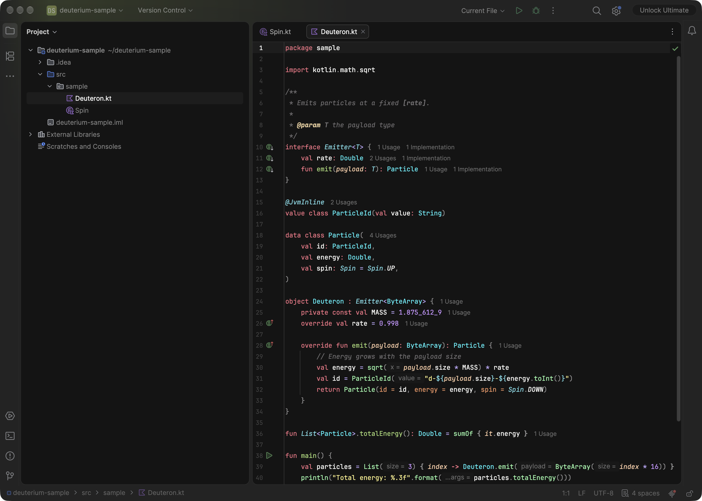
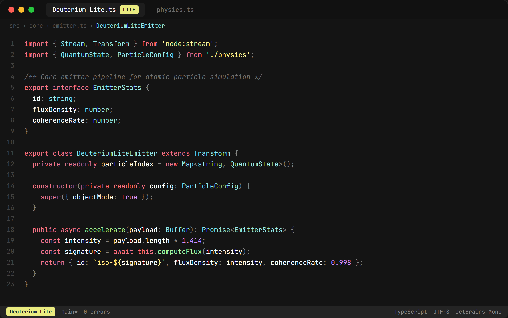

# Deuterium Color Themes for JetBrains

[](./package.json)
[]()
[](./LICENSE)

Dark UI themes and editor color schemes for JetBrains IDEs on the Islands UI, including IntelliJ IDEA, Android Studio, PyCharm, WebStorm, CLion, Rider, and GoLand. The plugin requires build 253 (2025.3) or later.

---

## Installation

Install the plugin using one of the following methods:

- Search for `Deuterium` directly within the IDE plugins marketplace via `Ctrl+Alt+S` > `Plugins` > `Marketplace`.
- Download `deuterium-<version>.jar` from the GitHub release and install via `Ctrl+Alt+S` > `Plugins` > gear icon > `Install Plugin from Disk...`.

Deuterium is also published for Visual Studio Code and Antigravity IDE:

- [VS Code Marketplace](https://marketplace.visualstudio.com/items?itemName=andreidurlea.deutherium)
- [Open VSX Registry](https://open-vsx.org/extension/andreidurlea/deutherium)
- [VS Code Theme Source](https://github.com/AndreiDurlea/my-vscode-theme)

---

## Themes

Each theme pairs a UI theme (`themes/*.theme.json`, parent `Islands Dark`) with an editor color scheme of the same name (`colors/*.xml`, parent `Darcula`).

| Theme | Theme ID | Editor background | Window frame | Accent |
| :- | :- | :- | :- | :- |
| Deuterium | `andreidurlea.deuterium` | `#0d0d0d` | `#1c1c1c` | Infrared `#ff4e32` |
| Deuterium Lite | `andreidurlea.deuterium-lite` | `#141414` | `#232323` | Limelight `#edf77a` |

The UI theme overrides the Islands Dark color tokens (`layer-*`, `text-*`, `accent-brand-*`, `selection-*`, `tab-*`) and sets 151 UI keys directly. The accent colors default buttons, toggles, progress bars, live templates and the modified-tab marker.

---

## Syntax Colors

Syntax attributes come from Lotus Dark (Classic) by Brian Lai, used under the MIT License. The generator reads the unmodified scheme from `vendor/lotus-theme-jetbrains/Lotus_Dark.xml`. Its license ships next to it and inside the plugin as `META-INF/LICENSE-lotus-theme-jetbrains`.

| Role | Color | Attribute keys |
| :- | :- | :- |
| Keyword | `#ff4c8f` italic, `#ff6188` italic in Java and Kotlin | `DEFAULT_KEYWORD`, `JAVA_KEYWORD` |
| String | `#fff48a` | `DEFAULT_STRING` |
| Number | `#c994ff` | `DEFAULT_NUMBER` |
| Class and object, declaration and reference in Java and Kotlin | `#33f3ff` | `DEFAULT_CLASS_NAME`, `KOTLIN_CLASS`, `KOTLIN_OBJECT` |
| Class reference in other languages | `#78dce8` | `DEFAULT_CLASS_REFERENCE` |
| Interface, type parameter, annotation | `#78dce8` italic | `DEFAULT_INTERFACE_NAME`, `TYPE_PARAMETER_NAME_ATTRIBUTES`, `ANNOTATION_NAME_ATTRIBUTES` |
| Function declaration | `#a9dc76` | `DEFAULT_FUNCTION_DECLARATION` |
| Function call | `#99ffae` | `DEFAULT_FUNCTION_CALL`, `DEFAULT_STATIC_METHOD` |
| `@Composable` call | `#6bb38a` | `IntelliJComposableCallTextAttributes` |
| Parameter | `#ffcfa8` italic | `DEFAULT_PARAMETER` |
| Named argument | `#f59762` | `KOTLIN_NAMED_ARGUMENT` |
| Operator | `#c0aaff` | `DEFAULT_OPERATION_SIGN` |
| Punctuation | `#939293` | `DEFAULT_PARENTHS`, `DEFAULT_BRACES`, `DEFAULT_COMMA` |
| Comment | `#727072` italic | `DEFAULT_LINE_COMMENT`, `DEFAULT_BLOCK_COMMENT` |

The scheme keeps 370 of the 434 Lotus attributes unchanged. The other 64 are editor chrome (diagnostics, search results, diff, console, breadcrumbs, inlay hints, debugger), which use Deuterium colors from `src/scheme.mjs`. That file also sets 46 syntax keys that Lotus leaves unset, so no Darcula syntax color shows between Lotus colors.

---

## Building

The plugin is a resource-only JAR with no compiled code. Node.js 20 or later generates and packages it.

```bash
npm run generate
```

```bash
npm run package
```

| Command | Output |
| :- | :- |
| `npm run generate` | Writes `resources/META-INF/plugin.xml`, `resources/themes/*.theme.json` and `resources/colors/*.xml`. |
| `npm run package` | Runs `generate`, then zips `resources/` into `dist/deuterium-<version>.jar` with the `zip` CLI. |

The version in `plugin.xml` comes from `package.json`. Pushing to `main` runs the release workflow, which bumps the patch version, builds the JAR and attaches it to a GitHub release. When the `JETBRAINS_MARKETPLACE_TOKEN` repository secret is set, the workflow also uploads the JAR to the JetBrains Marketplace as an update to `com.andreidurlea.deuterium`.

| Path | Contents |
| :- | :- |
| `src/palette.mjs` | Theme variants, UI and editor chrome colors |
| `src/ui.mjs` | UI theme builder |
| `src/scheme.mjs` | Editor scheme builder: Lotus syntax, gap keys, Deuterium chrome |
| `vendor/lotus-theme-jetbrains/` | Lotus Dark (Classic) scheme and MIT license |
| `resources/` | Generated plugin files, ignored by git |

---

## Previews

### Deuterium (Classic)



---

### Deuterium Lite



---

## Activation

1. Open settings using `Ctrl+Alt+S` (or `Cmd+,` on macOS).
2. Navigate to `Appearance & Behavior` > `Appearance`.
3. Select `Deuterium` or `Deuterium Lite` from the `Theme` dropdown menu.

Selecting a theme also selects its editor color scheme. For typography matching the intended design palette, use the [JetBrains Mono](https://www.jetbrains.com/lp/mono/) font.
